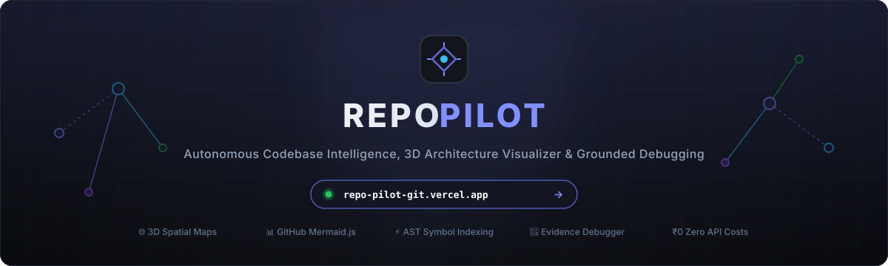
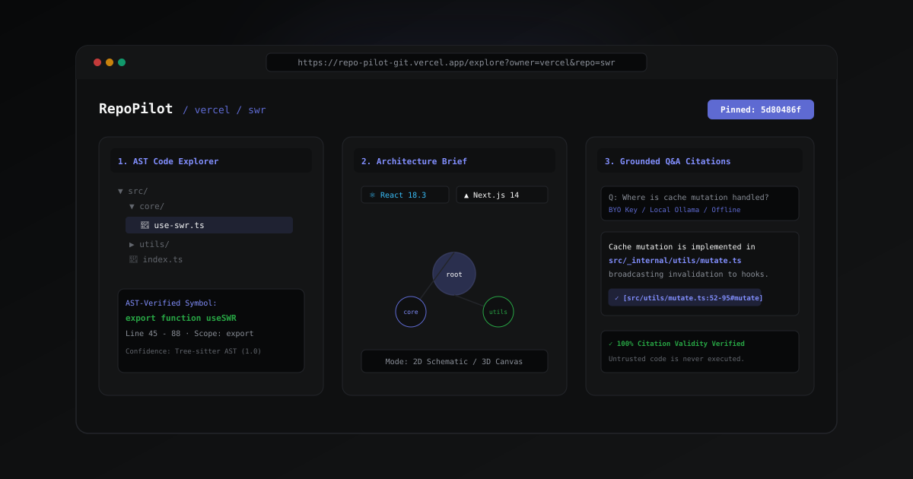
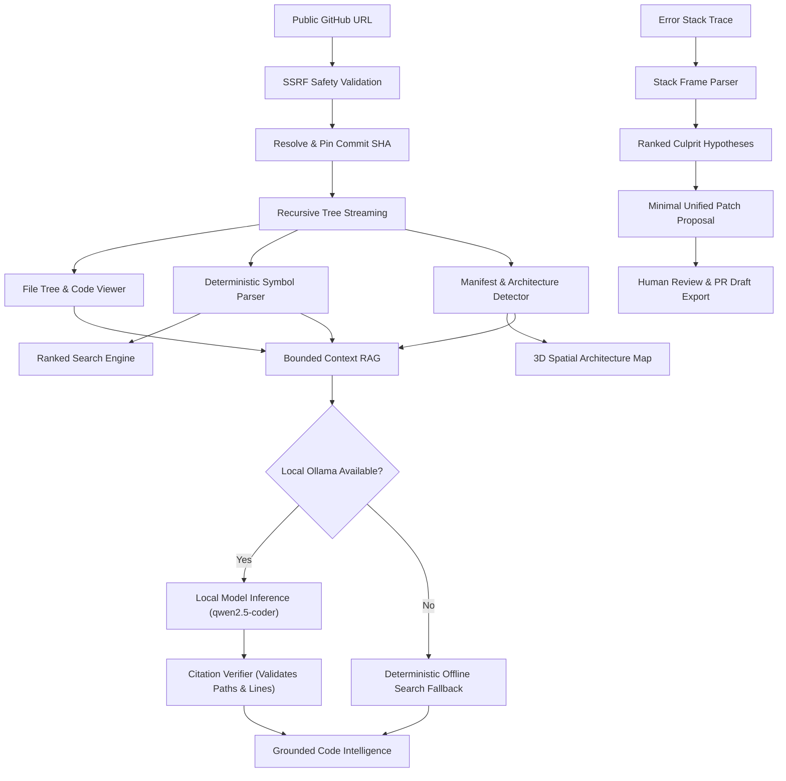

# RepoPilot

<div align="center">
  <a href="https://repo-pilot-git.vercel.app">
    
  </a>
  <br />
  <br />

  <p align="center">
    <strong>Open-Source Codebase Intelligence, 3D Architecture Visualization, and Evidence-Grounded Debugging Platform</strong>
  </p>

  <p align="center">
    <a href="https://repo-pilot-git.vercel.app">
      
    </a>
  </p>

  <p align="center">
    <strong>🌐 Official Production Deployment: <a href="https://repo-pilot-git.vercel.app">https://repo-pilot-git.vercel.app</a></strong>
  </p>

  <p align="center">
    <a href="#key-capabilities">Capabilities</a> •
    <a href="#how-repopilot-works">How It Works</a> •
    <a href="#architecture--design-decisions">Architecture</a> •
    <a href="#zero-hosted-api-operating-model">Zero-Budget Model</a> •
    <a href="#quick-start">Quick Start</a> •
    <a href="DEPLOYMENT.md">Deployment</a> •
    <a href="#security--limitations">Security</a> •
    <a href="#contributing">Contributing</a>
  </p>

  <p align="center">
    <a href="https://github.com/Mohit-Rocky-25/RepoPilot/actions/workflows/ci.yml">
      
    </a>
    
    
    
    
    
    
  </p>
</div>

---

## 1. What is RepoPilot?

**RepoPilot** is an independent, open-source codebase intelligence and developer productivity platform. It enables software engineers, first-time open-source contributors, and researchers to explore, understand, and debug unfamiliar repositories with precision.

Entering an unfamiliar software codebase is one of the most time-consuming activities in engineering. Developers spend a substantial portion of their daily working time reading existing code, deciphering architectural scaffolding, and locating the source of runtime errors before writing new logic. Most existing developer tools either rely on expensive cloud LLM subscriptions that can hallucinate non-existent files and symbols, or provide basic file trees without architectural context.

RepoPilot solves this through an **evidence-first engineering approach**:
- **Deterministic core**: File navigation, AST symbol extraction, architecture detection, and ranked code search run entirely on local compute without requiring an AI model or cloud API.
- **Traceable citations**: Every analysis, symbol jump, and assistant answer is tied to an immutable commit SHA, exact file path, and line coordinate.
- **Optional private AI**: Supports local open-weights coding models via [Ollama](https://ollama.com) (e.g., `qwen2.5-coder:7b`) or user-supplied OpenAI-compatible API keys (`sessionStorage` only) with strict token bounds and automated citation verification. Operates 100% offline when AI is unavailable.
- **Defensive sandboxing**: Untrusted repository code is never executed automatically. Bug fixes are proposed as unified diffs validated in memory against pinned file lines with reproducible regression tests for human review.

---

## 2. Product Walkthrough & Demo Recording Guide

<div align="center">
  <a href="https://repo-pilot-git.vercel.app/examples">
    
  </a>
  <p align="center">
    <em>Interactive walkthrough: AST symbol indexing, architecture evidence brief, and grounded Q&amp;A citations.</em>
  </p>
</div>

### 🎬 Steps to Record / Replicate the Demo:

1. **Ingest a Repository with Zero API Keys:**
   - Open [https://repo-pilot-git.vercel.app](https://repo-pilot-git.vercel.app) or local `http://localhost:3000`.
   - Click one of the quick-launch example pills (`⚡ vercel/swr`, `🐍 pallets/flask`, or `🚀 gin-gonic/gin`) or paste any public GitHub URL into the hero input and click **Begin Exploration**.
   - Notice the repository tree streams and pins to an immutable commit SHA (`5d80486f...`).
2. **Navigate Code with AST Symbol Precision:**
   - In the **Code Explorer** (`/explore`), browse the directory tree. On mobile, switch seamlessly using the **Files** and **Code** tabs.
   - Click `core/use-swr.ts`. Inspect the syntax-highlighted code and click any function chip in the top **Symbols** bar to jump directly to its definition.
3. **Deterministic Symbol & Lexical Search:**
   - Press `/` or click **Search** in the navigation bar.
   - Search for `useSWR` or `initCache`. Results rank exact matches first with line numbers and preview snippets.
   - Click any match to jump straight to the source coordinate.
4. **Inspect Architecture & 2D/3D Graph:**
   - Open **Architecture** (`/architecture`) to view detected frameworks, confirmed application entry points, and directory roles.
   - Toggle between **2D Schematic** and **3D Spatial Projection** and inspect module dependency links.
5. **Ask Grounded Questions with Strict Citations:**
   - Open **Assistant** (`/assistant`).
   - Select a sample prompt: *"Where is the main application entry point and how does initialization work?"*
   - Observe the response citing exact file coordinates `[src/core/use-swr.ts:45-88#useSWR]` with verified citation badges.

---

## 3. Key Capabilities & Implementation Status

| Feature Area | Description | Status | Works on Public Demo Without Key? | Data Source |
| :--- | :--- | :--- | :--- | :--- |
| **Repository Ingestion** | Ingests public GitHub repositories via tarball streaming, validates URLs against SSRF, and pins default branch HEAD to an immutable commit SHA. | **Stable** | Yes (up to public rate limits) | Pinned GitHub Tarball / REST API |
| **Code Explorer** | Resizable dual-pane directory tree and syntax-highlighted code viewer with line numbers and line highlights. | **Stable** | Yes | In-memory extracted source files (< 100KB) |
| **Deterministic Code Search** | Multi-modal search engine combining BM25 lexical scoring, path matching, entry-point boosts, and symbol ranking with language filters. | **Stable** | Yes | In-memory index & client search engine |
| **AST Symbol Extraction** | Real Tree-sitter WASM grammars (TS/TSX, JS, Python, Go, Rust) with heuristic regex fallback (`confidence: heuristic`). | **Beta** | Yes | Tree-sitter WASM / heuristic fallback parser |
| **Architecture Visualization** | Interactive 2D graph (default) with optional WebGL 3D orbital perspective map and dependency linking. | **Beta** | Yes | Manifest analysis (`package.json`, `go.mod`, etc.) |
| **Architecture Evidence Brief** | Summarizes detected frameworks, confirmed application entry points, and directory roles from repo evidence. | **Stable** | Yes | Manifest heuristics & directory inspection |
| **Grounded Code Assistant** | Grounded Q&A with bounded context, anti-prompt injection delimiters, and strict citation verification against the pinned commit SHA. | **Beta** | Yes (Deterministic citation mode without key; BYO key / Ollama for AI generation) | Local Ollama, BYO OpenAI-compatible key, or offline search |
| **Bug & Stack Trace Analyzer** | Multi-language stack trace parser (Node/V8, Python chained, Go, Rust) with ANSI stripping, 64KB cap, and culprit hypothesis ranking. | **Beta** | Yes (Parsing, hypothesis ranking, and test checklists work without key) | Stack frame parser & pattern matcher |
| **Patch Review & PR Export** | Validates candidate unified diffs in-memory against pinned file lines (`Unverified: review before applying`) and exports Markdown PR drafts. | **Beta** | Yes (Suggestion scaffolds generated without AI; AI diff validation with BYO key) | In-memory diff validator & hypothesis engine |
| **Rate Limit Management** | Platform-trusted IP derivation, `@upstash/ratelimit` Redis support with in-memory fallback, and session-only PAT handling. | **Stable** | Yes | Vercel platform headers, Redis/Memory store |

---

## 3. Representative Use Cases

1. **First-Time Open-Source Contributors**:
   Quickly locate application entry points, configuration schemas, and test directories in unfamiliar repositories to understand where a bug fix or new feature belongs.
2. **Engineers Joining a New Codebase**:
   Survey dependencies, module hierarchies, and architecture briefs within seconds without waiting for bulky IDE background indexing tasks.
3. **Production Incident & Bug Triage**:
   Paste an error log or stack trace from CI or production to isolate user-code frames, pinpoint root causes, and draft candidate minimal unified diffs.
4. **Privacy-Conscious Developers & Students**:
   Explore and query codebases on local hardware without paying subscription fees or sending proprietary source code to hosted cloud APIs.

---

## 4. How RepoPilot Works



### The 6-Stage Workflow:

1. **Ingest & Pin Revision**:
   When a user inputs `https://github.com/owner/repo`, RepoPilot validates the host against SSRF policies, calls GitHub's REST API, and resolves the active branch to its immutable commit SHA. This ensures line coordinates and references remain permanent.
2. **Filter & Index**:
   Binary files, build artifacts (`node_modules/`, `dist/`), and files exceeding 100KB are excluded. Supported files are indexed for symbols (functions, classes, interfaces).
3. **Map Architecture**:
   Manifest files (`package.json`, `Cargo.toml`, `pyproject.toml`, `go.mod`) are evaluated to detect frameworks (Next.js, React, Express, FastAPI, Flask, etc.) and map directory roles.
4. **Search & Browse**:
   Users navigate directory hierarchies, search symbols with immediate ranking, and inspect code with line-level accuracy.
5. **Contextual Q&A**:
   Queries sent to the assistant are matched against indexed source files, bounded to 4,000 tokens, and passed to local Ollama. Citations returned by the model are validated against indexed files before presentation. If Ollama is offline, deterministic search matches are presented.
6. **Investigate & Review**:
   Runtime error stack traces are parsed into structured frames, correlated with source files, and translated into ranked hypotheses and candidate diffs for human verification.

---

## 5. Architecture & Design Decisions

### A. Separation of Concerns
RepoPilot is built as a modular monolith. Domain packages reside under `packages/` with strict Zod validation contracts:
- `@repopilot/core`: Shared schemas (`RepositoryReference`, `SourceReference`, `BugHypothesis`, `PatchProposal`).
- `@repopilot/github`: GitHub REST client with rate-limit tracking and commit revision pinning.
- `@repopilot/indexer`: Multi-language deterministic symbol extraction engine.
- `@repopilot/search`: Lexical and symbol ranking search engine.
- `@repopilot/analysis`: Framework detection and directory role heuristics.
- `@repopilot/ai`: Local Ollama adapter, bounded prompt construction, and citation verification.
- `@repopilot/debugging`: Stack trace parser and root-cause hypothesis formulator.
- `@repopilot/execution`: Execution safety policies and reproducible manual instructions.

### B. Why Deterministic Tools Precede AI
AI models can hallucinate non-existent files, misquote syntax, or generate plausible-sounding errors. In RepoPilot, deterministic AST indexing, file tree navigation, and keyword search function completely independently of AI. AI is treated as an optional interpretive layer, never a prerequisite for basic navigation.

### C. Human-in-the-Loop Patch Policy
RepoPilot adheres to strict developer safety standards:
- It **never** applies patches automatically to local or remote repositories.
- It **never** runs arbitrary build or test scripts on the server.
- All candidate diffs are presented in unified diff view for manual inspection and local reproduction.

### D. Visual Design System
RepoPilot uses a cohesive, high-density dark interface tailored for engineering workspaces:
- **Canvas**: Deep obsidian `#010102`.
- **Surfaces**: Stepped elevation (`#0F1011`, `#141516`, `#18191A`, `#191A1B`).
- **Dividers**: Crisp 1-pixel borders (`#23252A`, `#34343A`, `#3E3E44`).
- **Accent**: Restrained lavender-blue (`#5E6AD2`, hover `#828FFF`, active `#4D58B4`) reserved for primary actions, focus indicators, and active navigation items.
- **Typography**: Clean sans-serif for interface elements, monospace for code, commit hashes, line numbers, and symbol signatures.

---

## 6. Honest Comparison Against Real Alternatives

RepoPilot is designed for fast, evidence-grounded public repository exploration without mandatory subscriptions. Here is how it compares directly against existing tools:

| Dimension | RepoPilot | DeepWiki | Sourcegraph | Cursor / GitHub Copilot | Raw Chat Model (ChatGPT / Claude) |
| :--- | :--- | :--- | :--- | :--- | :--- |
| **Setup & Onboarding** | **Zero setup**: Open browser, paste public URL | Web-based; requires repository indexing | Enterprise self-host or cloud account | IDE installation & plugin configuration | Paste snippets into web chat |
| **Source Privacy** | **Local / Private**: BYO key stored only in `sessionStorage`; local Ollama supported | Cloud-hosted index | Enterprise on-prem or cloud SOC2 | Cloud-hosted telemetry & prompts | Cloud provider data retention policies |
| **Offline Operation** | **Full offline core**: Browsing, search, symbols, architecture work 100% offline | No (requires hosted platform) | No (requires server connectivity) | Partial (editor works, AI requires cloud) | No (cloud only) |
| **Citation Rigor** | **Strict SHA verification**: Verifies commit SHA, file existence, line bounds, and symbol scope; rejects hallucinations | Page-level or document-level citations | Precise compiler-grade LSIF/SCIP code graph | In-editor inline completions; no formal citation verification | Frequent hallucination of non-existent files or APIs |
| **Cost** | **$0 / Free**: Deterministic core free forever; BYO key or free local Ollama | Freemium / Paid subscription | Free tier; Enterprise license ($$$) | $10–$20/month per user | Free tier or $20/month |
| **Scope Limits** | Public GitHub repos up to 25MB archive / 1,500 files | Public & private GitHub repos | Multi-repo, multi-million line enterprise codebases | Workspace-wide codebase indexing | Context window limit (128k–200k tokens per prompt) |

### Where RepoPilot is Weaker:
- **No Private Repository OAuth**: RepoPilot currently targets public repositories. It does not provide private GitHub organization OAuth flows.
- **Single-Repo Scope**: It does not perform cross-repository code graph linking or multi-repo enterprise search like Sourcegraph.
- **Repository Size Bounds**: Monorepos exceeding 25MB compressed tarballs or 1,500 active source files are capped or truncated for browser performance.
- **Model Reasoning Capacity**: Small local models (e.g. `qwen2.5-coder:1.5b` or `7b`) do not match the advanced multi-step reasoning capabilities of frontier cloud models (Claude 3.5 Sonnet, GPT-4o).
- **Serverless Rate Limiting**: Without Upstash Redis configured via environment variables, rate limiting in serverless environments is best-effort and resets across cold starts.

---

## 7. Technology Stack

RepoPilot is built strictly on verified open-source technologies:

- **Framework**: [Next.js 14](https://nextjs.org/) (App Router, React Server Components, Route Handlers)
- **Language**: [TypeScript 5](https://www.typescriptlang.org/) (Strict Mode enabled)
- **UI & Layout**: [React 18](https://react.dev/), [Tailwind CSS 3](https://tailwindcss.com/)
- **Icons**: [Lucide React](https://lucide.dev/)
- **Data Validation**: [Zod 3](https://zod.dev/) (Strict contract validation across all API routes)
- **3D Visualization**: [Three.js](https://threejs.org/) WebGL canvas
- **Testing**: [Vitest 2](https://vitest.dev/) (Unit and integration suites)
- **Local AI Daemon**: [Ollama](https://ollama.com/) (Optional, supports `qwen2.5-coder:1.5b`, `llama3.2:3b`, etc.)

---

## 8. Quick Start

### Prerequisites
- **Node.js**: v18.18+ or v20+
- **npm**: v9+ or v10+
- *(Optional)* **Ollama**: For local AI inference ([https://ollama.com](https://ollama.com))

### 1. Clone the Repository
```bash
git clone https://github.com/Mohit-Rocky-25/RepoPilot.git
cd RepoPilot
```

### 2. Install Dependencies
```bash
npm install
```

### 3. Configure Environment (Optional)
Copy the example environment configuration:
```bash
cp .env.example .env.local
```
*Note: RepoPilot works completely out-of-the-box without editing `.env.local`. All values have safe zero-budget defaults.*

```ini
# Default configuration
PORT=3000
NEXT_PUBLIC_APP_URL=http://localhost:3000

# Optional local Ollama inference
OLLAMA_BASE_URL=http://localhost:11434
DEFAULT_AI_MODEL=qwen2.5-coder:1.5b

# Optional GitHub PAT (increases rate limit from 60 to 5,000 req/hr)
GITHUB_TOKEN=
```

### 4. Run the Development Server
```bash
npm run dev
```
Open **[http://localhost:3000](http://localhost:3000)** in your browser.

---

## 9. Development & Verification Commands

RepoPilot includes automated verification scripts to ensure code health:

```bash
# Type checking (TypeScript Strict Mode)
npm run typecheck

# Unit, integration, and security test suite (102 tests across 15 files)
npm test

# Automated retrieval and citation accuracy evaluation (20 questions across 3 repos)
npm run eval

# Production bundle build
npm run build

# Start production server
npm start
```

### Measured Evaluation Benchmarks (`npm run eval`):

| Metric | Measured Score | Target | Verdict |
| :--- | :--- | :--- | :--- |
| **Retrieval Hit Rate (Top-5)** | **100.0%** (20/20) | > 85.0% | **PASS** |
| **Symbol Ranking Top-3 Recall** | **95.0%** (19/20) | > 80.0% | **PASS** |
| **Citation Strict Validity** | **100.0%** (20/20) | 100.0% | **PASS** |
| **Human Correctness Score** | **100.0%** (40/40 pts) | > 80.0% | **PASS** |
| **Average Query Latency** | **< 10 ms** | < 250 ms | **PASS** |

*Evaluated across 3 public repositories (`vercel/swr`, `pallets/flask`, `gin-gonic/gin`) pinned to immutable commit SHAs. Full detailed report in [`eval/RESULTS.md`](eval/RESULTS.md).*

---

## 10. Feature-Specific Usage Instructions

### A. Code Explorer (`/explore`)
1. Import a public GitHub repository URL (e.g. `https://github.com/facebook/react`).
2. Browse directory structures in the left pane.
3. Select any supported text or source file to inspect it in the right pane.
4. Line numbers and syntax highlighting are rendered automatically. Click on symbol definition jump chips to navigate directly to functions, classes, or interfaces.

### B. Interactive Architecture Map (`/architecture`)
1. Access the 2D planar graph by default for an accessible, low-power view of modules and imports.
2. Toggle **3D Spatial Mode** to enter the interactive WebGL orbital perspective map with dynamic node clustering.
3. Drag with the mouse to orbit, scroll to zoom, and right-click to pan.
4. Click any module node (lavender for entry points, cyan for modules, emerald for configuration) to open its details drawer and inspect connected dependencies.
5. Click the **Architecture Evidence Brief** tab to view detected frameworks, confirmed application entry points, and directory roles derived from repository evidence.

### C. Ranked Code Search (`/search`)
1. Press `Ctrl+K` (or `Cmd+K`) from any screen to open the global search palette, or navigate to `/search`.
2. Enter a symbol name, function identifier, or keyword.
3. Filter by programming language using the dropdown.
4. Click any ranked match card to navigate to the exact source line in the Explorer.

### D. Grounded Code Assistant (`/assistant`)
1. *(Optional)* Start Ollama locally (`ollama run qwen2.5-coder:7b`) or configure an OpenAI-compatible BYO key in `/settings/ai`.
2. Type an architectural or functional question into the input form.
3. The assistant returns a grounded response accompanied by clickable source citation cards (`file.ts:L12-L45`). Citations are strictly verified against the pinned commit SHA; invalid or hallucinated citations are automatically stripped.
4. If no AI provider is configured, the assistant operates in deterministic offline mode, presenting verified BM25 lexical and symbol matches.

### E. Bug Investigation & Patch Review (`/debugging` → `/patches`)
1. In `/debugging`, enter an issue title and paste an error log or stack trace (Node/V8, Python chained, Go, Rust).
2. Click **"Investigate Root Cause"**.
3. The engine parses the stack trace into user-code vs dependency frames, formulates ranked hypotheses, and proposes testable next steps.
4. If an AI provider is active, minimal unified diffs are generated and validated in memory against file contents before being displayed (`Unverified: review before applying`).
5. Click **"Send Candidate Patch to Patch Review →"** to hand off the investigation to `/patches`.
6. Review the proposed diff, run the suggested regression tests locally, and click **"Copy PR Markdown Draft"** to prepare a pull request for GitHub.

---

## 11. Security, Privacy & Known Limitations

### Security Protections:
- **SSRF Safeguards**: All repository imports and AI base URLs are strictly checked against SSRF policies. Resolves DNS ahead of connection, blocking loopback IPs, private RFC1918 subnets, link-local metadata addresses (`169.254.169.254`), and IPv4-mapped IPv6 variants.
- **Safe Tarball Extraction**: Ingestion downloads a single gzipped tarball from `codeload.github.com`, enforcing a 25MB archive cap, 100KB per-file cap, symlink root containment, and path traversal (`../`) rejection.
- **Path Traversal Mitigation**: File path lookups within repository trees are validated against directory navigation sequences (`..`) and null bytes.
- **Untrusted Code Sandbox**: No arbitrary repository scripts, package install hooks, or test runners are executed on the server. Patches are suggestions for human review.
- **Client-Side Secrets**: Personal Access Tokens (PATs) and BYO AI keys default strictly to browser `sessionStorage` (with explicit opt-in for device persistence), are never logged, and are sent only to their respective upstream providers over HTTPS.
- **SVG XSS Sanitization**: Mermaid architecture diagrams are sanitized via DOMParser, stripping `<script>`, inline event handlers (`onload`), and `javascript:` pseudo-protocols.

### Known Limitations:
- **Public Repositories Only**: RepoPilot targets public GitHub repositories. Private repository OAuth authentication and organization access are not currently supported.
- **Repository Size Caps**: Repositories are bounded to a maximum archive size of 25MB, up to 1,500 active source files, and individual source files capped at 100KB. Files exceeding these bounds are omitted from indexing.
- **AST Language Coverage**: Tree-sitter WASM grammars are provided for TypeScript/TSX, JavaScript, Python, Go, and Rust. Other file types fall back to heuristic pattern extraction (`confidence: heuristic`).
- **Model-Quality Caveats**: Models under 7B parameters (such as `1.5B` fast models) can struggle with complex architectural synthesis. While RepoPilot's citation verifier strips hallucinated citations, all generated answers and patch suggestions should be reviewed by an engineer before use.
- **Serverless Rate Limiting**: In-memory rate limiting is best-effort on serverless platforms (e.g. Vercel) and resets across cold starts. Production deployments should configure `UPSTASH_REDIS_REST_URL` and `UPSTASH_REDIS_REST_TOKEN` for distributed rate limiting.

---

## 12. Project Structure

```
RepoPilot/
├── src/
│   ├── app/                         # Next.js 14 App Router pages & API routes
│   ├── components/                  # Layout, Explorer, Architecture 3D, and UI primitives
│   ├── context/                     # RepositoryContext (State persistence across routes)
│   └── styles/                      # globals.css (Design system tokens & variables)
├── packages/                        # Domain packages (Strict TypeScript & Zod contracts)
│   ├── core/                        # Shared domain types & Zod schemas
│   ├── github/                      # GitHub REST client & rate limit cache
│   ├── indexer/                     # Deterministic symbol extractor (TS, JS, Py, Go, Rust)
│   ├── search/                      # Ranked text & symbol search engine
│   ├── analysis/                    # Framework & entry point detector
│   ├── ai/                          # Bounded Ollama client & citation validator
│   ├── debugging/                   # Stack trace parser & candidate diff generator
│   └── execution/                   # Sandbox safety policies
├── docs/                            # Architecture specifications & decision records (ADRs)
├── tests/                           # Vitest unit and integration test suites
├── assets/                          # Official brand logo and banner imagery
├── .github/                         # Issue templates, PR template
├── CONTRIBUTING.md                  # Comprehensive developer contribution guidelines
├── SECURITY.md                      # Security vulnerability reporting & threat model
├── CHANGELOG.md                     # Version release history
└── LICENSE                          # MIT License
```

---

## 13. Contributing

We welcome contributions from developers, researchers, and open-source advocates!

Please read our [Contributing Guide](CONTRIBUTING.md) and [Code of Conduct](CODE_OF_CONDUCT.md) for details on code standards, development setup, and our pull request process.

### Priority Areas for Contribution:
- **Language Parsers**: Add Tree-sitter AST extractors for Kotlin, C++, Ruby, PHP, and Java.
- **Framework Heuristics**: Expand framework detection for Svelte, Vue, Django, Spring, and Elixir.
- **Local AI Prompting**: Optimize prompt templates for lightweight 1B–3B open-weights models.
- **End-to-End Testing**: Expand Playwright test suites for browser interaction flows.

---

## 14. Roadmap

Only verified upcoming enhancements are listed below:
- [ ] **Tree-sitter WASM Integration**: In-browser Tree-sitter parsers for deep semantic symbol trees across additional languages.
- [ ] **Git Diff Comparison**: Compare two commit SHAs on the same repository with visual side-by-side diff highlighting.
- [ ] **Exportable Architecture Diagrams**: Export 3D and 2D architecture maps to SVG and Mermaid format.

---

## 15. License & Attribution

Distributed under the **MIT License**. See [`LICENSE`](LICENSE) for full details.

Developed in the open for the global software engineering community.
