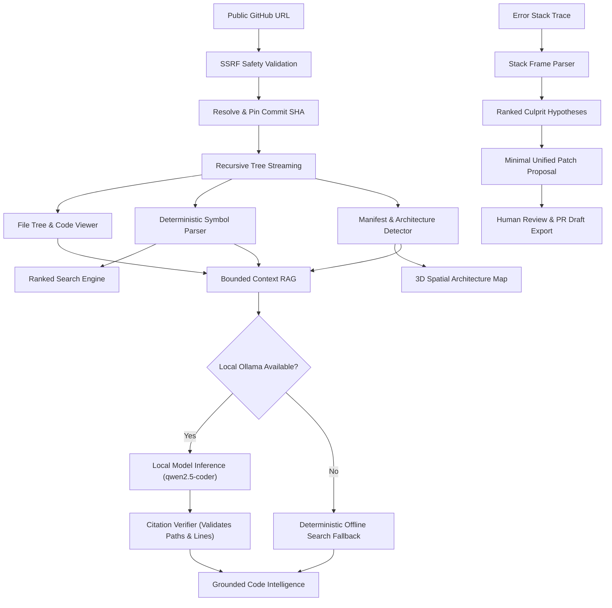

# RepoPilot

<div align="center">
  
  <br />
  <br />

  <p align="center">
    <strong>Open-Source Codebase Intelligence, Architecture Visualization, and Evidence-Grounded Debugging Platform</strong>
  </p>

  <p align="center">
    <a href="#key-capabilities">Capabilities</a> •
    <a href="#how-repopilot-works">How It Works</a> •
    <a href="#architecture--design-decisions">Architecture</a> •
    <a href="#zero-hosted-api-operating-model">Zero-Budget Model</a> •
    <a href="#quick-start">Quick Start</a> •
    <a href="DEPLOYMENT.md">Deployment</a> •
    <a href="#security--limitations">Security</a> •
    <a href="#contributing">Contributing</a>
  </p>

  <p align="center">
    <a href="https://repo-pilot-git.vercel.app"></a>
    
    
    
    
    
    
  </p>
</div>

---

## 1. What is RepoPilot?

**RepoPilot** is an independent, open-source codebase intelligence and developer productivity platform. It enables software engineers, first-time open-source contributors, and researchers to explore, understand, and debug unfamiliar repositories with precision.

Entering an unfamiliar software codebase is one of the most time-consuming activities in engineering. Developers spend up to 70% of their time reading code, deciphering architectural scaffolding, and locating the source of runtime errors. Most existing developer tools either rely on expensive cloud LLM subscriptions that hallucinate non-existent files, or provide basic file trees without architectural context.

RepoPilot solves this through an **evidence-first engineering approach**:
- **Deterministic core**: File navigation, AST symbol extraction, architecture detection, and ranked code search run entirely on local compute without requiring an AI model or cloud API.
- **Traceable citations**: Every analysis, symbol jump, and assistant answer is tied to an immutable commit SHA, exact file path, and line coordinate.
- **Optional private AI**: Supports local open-weights coding models via [Ollama](https://ollama.com) (e.g., `qwen2.5-coder:1.5b`) with strict token bounds and automated citation verification. Operates 100% offline when Ollama is unavailable.
- **Defensive sandboxing**: Untrusted repository code is never executed automatically. Bug fixes are proposed as unified diffs with reproducible regression tests for human review.

---

## 2. Key Capabilities & Implementation Status

| Feature Area | Description | Implementation Status | Data Source |
| :--- | :--- | :--- | :--- |
| **Repository Ingestion** | Ingests public GitHub repositories, validates URLs, and pins default branch HEAD to an immutable commit SHA. | **Verified / Active** | Public GitHub REST API (`api.github.com`) |
| **Code Explorer** | Resizable dual-pane directory tree and syntax-highlighted code viewer with line numbers and line highlights. | **Verified / Active** | Pinned Git tree blobs (< 100KB) |
| **Deterministic Code Search** | Multi-modal search engine ranking file paths, AST symbols, and lexical matches with language filters. | **Verified / Active** | Client-side deterministic ranking engine |
| **AST Symbol Extraction** | Regex and AST pattern extractors parsing functions, classes, interfaces, and signatures across TS, JS, Python, Go, and Rust. | **Verified / Active** | Local AST pattern parser |
| **3D Architecture Visualization** | WebGL orbital perspective map with node selection, dependency linking, and accessible 2D planar mode. | **Verified / Active** | Manifest analysis (`package.json`, `go.mod`, etc.) |
| **Architecture Evidence Brief** | Summarizes detected frameworks, confirmed application entry points, and directory roles. | **Verified / Active** | Manifest heuristics & directory inspection |
| **Grounded Code Assistant** | Evidence-grounded conversational assistant with bounded prompt contexts and automated citation validation. | **Verified / Active** | Optional local Ollama (`qwen2.5-coder`) or offline fallback |
| **Bug & Stack Trace Analyzer** | Correlates Node/V8 and Python stack traces with repository source lines to formulate ranked root-cause hypotheses. | **Verified / Active** | Stack frame parser & pattern matcher |
| **Patch Review & PR Export** | Formulates candidate minimal unified diffs, regression test checklists, and exportable Markdown PR drafts. | **Verified / Active** | Local hypothesis diff engine |
| **Rate Limit Management** | Monitors GitHub REST quota headers and supports optional client-side Personal Access Tokens. | **Verified / Active** | Browser `LocalStorage` & GitHub response headers |

---

## 3. Representative Use Cases

1. **First-Time Open-Source Contributors**:
   Quickly locate application entry points, configuration schemas, and test directories in unfamiliar repositories to understand where a bug fix or new feature belongs.
2. **Engineers Joining a New Codebase**:
   Survey dependencies, module hierarchies, and architecture briefs within seconds without waiting for bulky IDE background indexing tasks.
3. **Production Incident & Bug Triage**:
   Paste an error log or stack trace from CI or production to isolate user-code frames, pinpoint root causes, and draft candidate minimal unified diffs.
4. **Privacy-Conscious Developers & Students**:
   Explore and query codebases on local hardware without paying subscription fees or sending proprietary source code to hosted cloud APIs.

---

## 4. How RepoPilot Works



### The 6-Stage Workflow:

1. **Ingest & Pin Revision**:
   When a user inputs `https://github.com/owner/repo`, RepoPilot validates the host against SSRF policies, calls GitHub's REST API, and resolves the active branch to its immutable commit SHA. This ensures line coordinates and references remain permanent.
2. **Filter & Index**:
   Binary files, build artifacts (`node_modules/`, `dist/`), and files exceeding 100KB are excluded. Supported files are indexed for symbols (functions, classes, interfaces).
3. **Map Architecture**:
   Manifest files (`package.json`, `Cargo.toml`, `pyproject.toml`, `go.mod`) are evaluated to detect frameworks (Next.js, React, Express, FastAPI, Flask, etc.) and map directory roles.
4. **Search & Browse**:
   Users navigate directory hierarchies, search symbols with immediate ranking, and inspect code with line-level accuracy.
5. **Contextual Q&A**:
   Queries sent to the assistant are matched against indexed source files, bounded to 4,000 tokens, and passed to local Ollama. Citations returned by the model are validated against indexed files before presentation. If Ollama is offline, deterministic search matches are presented.
6. **Investigate & Review**:
   Runtime error stack traces are parsed into structured frames, correlated with source files, and translated into ranked hypotheses and candidate diffs for human verification.

---

## 5. Architecture & Design Decisions

### A. Separation of Concerns
RepoPilot is built as a modular monolith. Domain packages reside under `packages/` with strict Zod validation contracts:
- `@repopilot/core`: Shared schemas (`RepositoryReference`, `SourceReference`, `BugHypothesis`, `PatchProposal`).
- `@repopilot/github`: GitHub REST client with rate-limit tracking and commit revision pinning.
- `@repopilot/indexer`: Multi-language deterministic symbol extraction engine.
- `@repopilot/search`: Lexical and symbol ranking search engine.
- `@repopilot/analysis`: Framework detection and directory role heuristics.
- `@repopilot/ai`: Local Ollama adapter, bounded prompt construction, and citation verification.
- `@repopilot/debugging`: Stack trace parser and root-cause hypothesis formulator.
- `@repopilot/execution`: Execution safety policies and reproducible manual instructions.

### B. Why Deterministic Tools Precede AI
AI models can hallucinate non-existent files, misquote syntax, or generate plausible-sounding errors. In RepoPilot, deterministic AST indexing, file tree navigation, and keyword search function completely independently of AI. AI is treated as an optional interpretive layer, never a prerequisite for basic navigation.

### C. Human-in-the-Loop Patch Policy
RepoPilot adheres to strict developer safety standards:
- It **never** applies patches automatically to local or remote repositories.
- It **never** runs arbitrary build or test scripts on the server.
- All candidate diffs are presented in unified diff view for manual inspection and local reproduction.

### D. Visual Design System
RepoPilot uses a cohesive, high-density dark interface tailored for engineering workspaces:
- **Canvas**: Deep obsidian `#010102`.
- **Surfaces**: Stepped elevation (`#0F1011`, `#141516`, `#18191A`, `#191A1B`).
- **Dividers**: Crisp 1-pixel borders (`#23252A`, `#34343A`, `#3E3E44`).
- **Accent**: Restrained lavender-blue (`#5E6AD2`, hover `#828FFF`, active `#4D58B4`) reserved for primary actions, focus indicators, and active navigation items.
- **Typography**: Clean sans-serif for interface elements, monospace for code, commit hashes, line numbers, and symbol signatures.

---

## 6. Zero-Hosted-API Operating Model

RepoPilot has a strict **₹0 / $0 operating cost**:

| Requirement | Conventional AI Platform | RepoPilot Architecture |
| :--- | :--- | :--- |
| **LLM Inference** | $20–$50/month hosted API subscriptions | **$0** (Optional local open-weights models via Ollama) |
| **Vector Database** | $50–$100/month managed Pinecone/Qdrant | **$0** (Local deterministic symbol tables & in-memory search) |
| **Repository Ingestion** | Paid third-party indexing services | **$0** (Public GitHub REST API with rate-limit monitoring) |
| **Infrastructure Hosting** | Multi-container cloud cluster | **$0** (Self-hosted single Node.js process) |
| **Telemetry & Tracking** | Commercial SaaS analytics | **$0** (Zero external telemetry; local client-side state) |

---

## 7. Technology Stack

RepoPilot is built strictly on verified open-source technologies:

- **Framework**: [Next.js 14](https://nextjs.org/) (App Router, React Server Components, Route Handlers)
- **Language**: [TypeScript 5](https://www.typescriptlang.org/) (Strict Mode enabled)
- **UI & Layout**: [React 18](https://react.dev/), [Tailwind CSS 3](https://tailwindcss.com/)
- **Icons**: [Lucide React](https://lucide.dev/)
- **Data Validation**: [Zod 3](https://zod.dev/) (Strict contract validation across all API routes)
- **3D Visualization**: [Three.js](https://threejs.org/) WebGL canvas
- **Testing**: [Vitest 2](https://vitest.dev/) (Unit and integration suites)
- **Local AI Daemon**: [Ollama](https://ollama.com/) (Optional, supports `qwen2.5-coder:1.5b`, `llama3.2:3b`, etc.)

---

## 8. Quick Start

### Prerequisites
- **Node.js**: v18.18+ or v20+
- **npm**: v9+ or v10+
- *(Optional)* **Ollama**: For local AI inference ([https://ollama.com](https://ollama.com))

### 1. Clone the Repository
```bash
git clone https://github.com/Mohit-Rocky-25/RepoPilot.git
cd RepoPilot
```

### 2. Install Dependencies
```bash
npm install
```

### 3. Configure Environment (Optional)
Copy the example environment configuration:
```bash
cp .env.example .env.local
```
*Note: RepoPilot works completely out-of-the-box without editing `.env.local`. All values have safe zero-budget defaults.*

```ini
# Default configuration
PORT=3000
NEXT_PUBLIC_APP_URL=http://localhost:3000

# Optional local Ollama inference
OLLAMA_BASE_URL=http://localhost:11434
DEFAULT_AI_MODEL=qwen2.5-coder:1.5b

# Optional GitHub PAT (increases rate limit from 60 to 5,000 req/hr)
GITHUB_TOKEN=
```

### 4. Run the Development Server
```bash
npm run dev
```
Open **[http://localhost:3000](http://localhost:3000)** in your browser.

---

## 9. Development & Verification Commands

RepoPilot includes automated verification scripts to ensure code health:

```bash
# Type checking (TypeScript Strict Mode)
npm run typecheck

# Unit and integration test suite (27 tests across 10 files)
npm test

# Production bundle build
npm run build

# Start production server
npm start
```

---

## 10. Feature-Specific Usage Instructions

### A. Code Explorer (`/explore`)
1. Import a public GitHub repository URL (e.g. `https://github.com/facebook/react`).
2. Browse directory structures in the left pane.
3. Select any supported text or source file to inspect it in the right pane.
4. Line numbers and syntax highlighting are rendered automatically. Click on symbol definition jump chips to navigate directly to functions, classes, or interfaces.

### B. Interactive 3D Spatial Architecture (`/architecture`)
1. Click the **3D Spatial Map** tab to enter the interactive WebGL orbital perspective.
2. Drag with the mouse to orbit, scroll to zoom, and right-click to pan.
3. Click any module node (lavender for entry points, cyan for modules, emerald for configuration) to open its details drawer and inspect connected dependencies.
4. Use the **2D Planar Mode** toggle for an accessible, low-power fallback view.
5. Click the **Architecture Evidence Brief** tab to view detected frameworks, confirmed application entry points, and directory roles derived from repository evidence.

### C. Ranked Code Search (`/search`)
1. Press `Ctrl+K` (or `Cmd+K`) from any screen to open the global search palette, or navigate to `/search`.
2. Enter a symbol name, function identifier, or keyword.
3. Filter by programming language using the dropdown.
4. Click any ranked match card to navigate to the exact source line in the Explorer.

### D. Grounded Code Assistant (`/assistant`)
1. *(Optional)* Start Ollama locally: `ollama run qwen2.5-coder:1.5b`.
2. Type an architectural or functional question into the input form.
3. The assistant returns a concise explanation accompanied by clickable source citation cards (`file.ts:L12-L45`).
4. If Ollama is offline, the assistant operates in deterministic fallback mode, retrieving exact matching source lines.

### E. Bug Investigation & Patch Review (`/debugging` → `/patches`)
1. In `/debugging`, enter an issue title and paste an error log or stack trace.
2. Click **"Investigate Root Cause"**.
3. The engine parses the stack trace into user-code frames, formulates ranked hypotheses, and drafts a candidate unified diff.
4. Click **"Send Candidate Patch to Patch Review →"** to hand off the investigation to `/patches`.
5. Review the proposed unified diff, verify the suggested regression tests locally, and click **"Copy PR Markdown Draft"** to prepare a pull request for GitHub.

---

## 11. Security, Privacy & Limitations

### Security Protections:
- **SSRF Safeguards**: All repository imports are strictly checked against `https://github.com/([a-zA-Z0-9_.-]+)/([a-zA-Z0-9_.-]+)`. Localhost and private IP ranges are rejected.
- **Path Traversal Mitigation**: File path lookups are validated against directory navigation sequences (`..`) and null bytes.
- **Untrusted Code Sandbox**: No arbitrary repository scripts, package install hooks, or test runners are executed on the server.
- **Client-Side Secrets**: Optional GitHub Personal Access Tokens are stored strictly in browser `LocalStorage` and never transmitted to third parties.

### Operating Limitations:
- **Unauthenticated GitHub Rate Limits**: GitHub limits unauthenticated requests to 60 requests per hour per IP. To increase this to 5,000 req/hr, provide an optional Personal Access Token in `/settings`.
- **Repository Tree Bounds**: For browser performance, repositories are indexed up to 1,500 source code files. Files exceeding 100KB and binary assets are automatically skipped.
- **Hardware for Local AI**: If using Ollama, 8GB+ of system RAM is recommended for lightweight models (1B–3B parameters). No GPU is required. The platform remains 100% operational without Ollama.

---

## 12. Project Structure

```
RepoPilot/
├── src/
│   ├── app/                         # Next.js 14 App Router pages & API routes
│   ├── components/                  # Layout, Explorer, Architecture 3D, and UI primitives
│   ├── context/                     # RepositoryContext (State persistence across routes)
│   └── styles/                      # globals.css (Design system tokens & variables)
├── packages/                        # Domain packages (Strict TypeScript & Zod contracts)
│   ├── core/                        # Shared domain types & Zod schemas
│   ├── github/                      # GitHub REST client & rate limit cache
│   ├── indexer/                     # Deterministic symbol extractor (TS, JS, Py, Go, Rust)
│   ├── search/                      # Ranked text & symbol search engine
│   ├── analysis/                    # Framework & entry point detector
│   ├── ai/                          # Bounded Ollama client & citation validator
│   ├── debugging/                   # Stack trace parser & candidate diff generator
│   └── execution/                   # Sandbox safety policies
├── docs/                            # Architecture specifications & decision records (ADRs)
├── tests/                           # Vitest unit and integration test suites
├── assets/                          # Official brand logo and banner imagery
├── .github/                         # Issue templates, PR template
├── CONTRIBUTING.md                  # Comprehensive developer contribution guidelines
├── SECURITY.md                      # Security vulnerability reporting & threat model
├── CHANGELOG.md                     # Version release history
└── LICENSE                          # MIT License
```

---

## 13. Contributing

We welcome contributions from developers, researchers, and open-source advocates!

Please read our [Contributing Guide](CONTRIBUTING.md) and [Code of Conduct](CODE_OF_CONDUCT.md) for details on code standards, development setup, and our pull request process.

### Priority Areas for Contribution:
- **Language Parsers**: Add Tree-sitter AST extractors for Kotlin, C++, Ruby, PHP, and Java.
- **Framework Heuristics**: Expand framework detection for Svelte, Vue, Django, Spring, and Elixir.
- **Local AI Prompting**: Optimize prompt templates for lightweight 1B–3B open-weights models.
- **End-to-End Testing**: Expand Playwright test suites for browser interaction flows.

---

## 14. Roadmap

Only verified upcoming enhancements are listed below:
- [ ] **Tree-sitter WASM Integration**: In-browser Tree-sitter parsers for deep semantic symbol trees across additional languages.
- [ ] **Git Diff Comparison**: Compare two commit SHAs on the same repository with visual side-by-side diff highlighting.
- [ ] **Exportable Architecture Diagrams**: Export 3D and 2D architecture maps to SVG and Mermaid format.

---

## 15. License & Attribution

Distributed under the **MIT License**. See [`LICENSE`](LICENSE) for full details.

Developed in the open for the global software engineering community.
